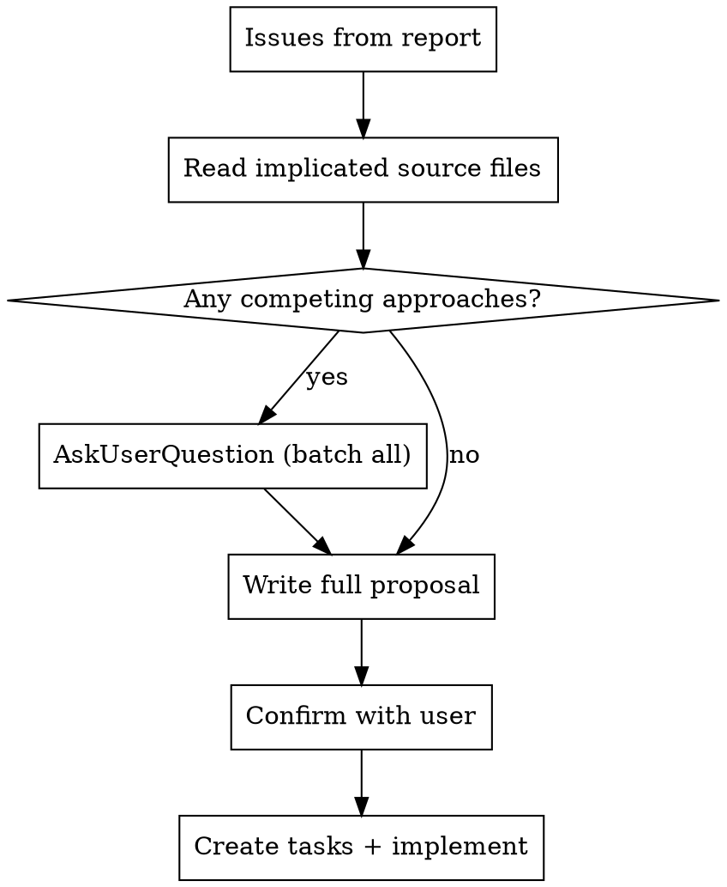

# Deep Reveal Judge

You are evaluating a batch of deep-reveal LLM explanations produced by `run_eval.mjs`.

## Input

The argument is a path to a `.jsonl` file. Each line is a JSON object with this shape:

```json
{
  "id": "eval-0",
  "board_state": "3253...",
  "move_played": 2,        // 0-indexed column played (the blunder)
  "correct_move": 3,       // 0-indexed column that was better
  "pattern_category": "claimeven",
  "predicates": ["P02","P28"],
  "severity": 4,
  "context_outcome": "success | null_returned | trivial | all_moves_equal | error",
  "context_error": null,
  "prompt": "<full LLM prompt>",
  "allowed_set": [...],
  "attempt1_response": "<raw LLM text>",
  "attempt1_passed": true,
  "attempt1_failures": [],
  "attempt2_response": null,
  "attempt2_passed": null,
  "attempt2_failures": [],
  "final_response": "<accepted response text or null>"
}
```

## Phase 1 — Score and report

### Step 1: Read and classify

Read the JSONL file. Classify each record into one of three buckets:

- **Pipeline failure**: `context_outcome` is not `success` — no LLM was called. Record the outcome type and `context_error` if present.
- **Annotation failure**: `context_outcome` is `success` but `final_response` is `null` — both validation attempts failed. Record the failure codes from `attempt1_failures` and `attempt2_failures`, and capture the full text of `attempt1_response` and `attempt2_response`.
- **Success**: `final_response` is non-null — will be scored in Step 2.

### Step 2: Score success records via sub-agents

For each success record, spawn a fresh `general-purpose` sub-agent to score the 9 rubric items. Process them **sequentially** (not in parallel — there can be 50+ entries). Each sub-agent receives only the data for that one record; it has no memory of other entries.

Construct the sub-agent prompt from this template, substituting the real values:

---
```
You are scoring a single Connect Four coaching explanation against a quality rubric.
Your output must be ONLY a valid JSON object — no prose, no markdown fences, nothing else.

## Record metadata
- id: <id>
- move_played: <move_played> (0-indexed) → column <move_played + 1> (1-indexed, as used in the explanation)
- correct_move: <correct_move> (0-indexed) → column <correct_move + 1> (1-indexed, as used in the explanation)
- pattern_category: <pattern_category>
- severity: <severity>

## Explanation to score
<final_response>

## Full prompt sent to LLM
<prompt>

## Pre-check: primary pattern identification

Before scoring, identify the PRIMARY tactical concept in the explanation — the
central claim about what the player missed, had, or gave away. Look at the main
clause of the opening sentence (or the concept most prominently framed as the
blunder diagnosis). Extract it as a short phrase.

Expected primary concept per category:
- claimeven        → "claimeven" / "even-row pairing"
- forced_win       → "forced win" / "forcing sequence"
- double_threat    → "double threat" / "fork" / "two threats"
- z_threat         → "Z-shape" / "parity advantage" / "odd capsule"
- figure_7         → "figure-7" / "diagonal fork"
- j_shape          → "J-shape"
- undercut         → "undercut" / "lower threat"
- overcut          → "overcut" / "upper threat"
- immediate_threat → "immediate threat" / "winning move right there"
- forced_block     → "forced block" / "opponent was about to win"
- drawing_move     → "draw" / "drawing resource" (NOT "forced win")
- odd_even_threat  → "odd-even threat" / "both parities" / "parity fork"
- suboptimal_move  → a reproducible board feature the player could find on their own (parity, a reachable fork/threat, who-completes-first, specific cells/columns). A purely generic positional claim with no board-grounded reason does NOT satisfy this — score it against item 9.

Write one line before the rubric scores:
`Primary pattern: "<phrase>" — matches / DOES NOT MATCH <pattern_category>`

Use this determination in item 3 scoring.

## Rubric

Score each item "pass", "partial", or "fail".

| # | Item | What to check |
|---|---|---|
| 1 | Correct column named | Does the explanation explicitly mention column <correct_move + 1>? Does it avoid naming wrong columns as the better move? |
| 2 | No hallucinated win or structure | Does it claim an immediate win exists when none does, or deny one when it does? Cross-check: `forced_win` pattern_category means a win exists; high severity alone does not. Also check: does the explanation assert a tactical structure (e.g. "major threat alive", "fork in place", "forcing sequence") that the boards do not show? The board visualizations explicitly state "Major threats: none" when there are none — if the explanation claims a major threat, minor threat, or concrete forcing structure exists when the boards show none, score fail. |
| 3 | Pattern match | Recall the primary pattern from the pre-check. Does it match `<pattern_category>`? The PRIMARY claim (the central blunder diagnosis — what the player missed or had) must match. Secondary supporting concepts mentioned alongside (e.g. `[term:parity]` inside a z_threat explanation) are acceptable. If the primary concept names a DIFFERENT pattern (e.g. "forced win" when category is `drawing_move`), score fail — even if the correct concept also appears elsewhere in the response. Mapping for secondary concepts: claimeven → zugzwang / even-row control; forced_win → forced sequence / forced win; double_threat → fork / two threats at once; z_threat → Z-shape / odd-row stacking; figure_7 → figure-7 / diagonal staircase; j_shape → J-shape; undercut → undercut / lower threat; overcut → overcut / upper threat; immediate_threat → immediate threat / blocking urgency; forced_block → forced block / defensive urgency; drawing_move → drawing / balanced outcome; odd_even_threat → parity / odd-even row strategy; suboptimal_move → a reproducible board feature (parity / reachable fork / threat / who-completes-first / specific cells); a generic positional claim with no player-findable reason is NOT a valid primary concept — score it against item 9. |
| 4 | Player perspective correct | Is the explanation from the blundering player's viewpoint ("you missed…", "your move…")? No confusion about who played vs who benefits. |
| 5 | Move location accuracy | Are the played move (column <move_played + 1>) and better move (column <correct_move + 1>) correctly attributed? No transposition between the two. |
| 6 | No internal terms leaked | Does the response use any banned words: `solver`, `score`, `leaf`, `leaf position`, `tag`, `direction`, `forced_win` as a noun, `simulation`, `pattern data`, `pattern comparison`? |
| 7 | Internal consistency | Does the better move's rationale directly address the specific weakness identified in the blunder? The diagnosis and remedy must be logically connected — not just "the other move was stronger." |
| 8 | Other issues | Anything not covered by another item: self-contradictory claims, wrong threat direction, misleading framing, factual errors about the board. Do NOT score vague/boilerplate / non-reproducible reasoning here — that now lives in item 9; do not double-count it. |
| 9 | Reproducible reasoning | Is the explanation's core reason a board feature the player could identify on their own — a threat, parity, a reachable fork, who-completes-first, specific cells/columns — rather than a score-flavored assertion ("stronger move", "loses slower", "higher-rated", "better evaluation") or generic positional filler ("kept your options open", "more room to build", "kept the structure intact", "lining up cleanly")? Score fail when the reason is score-flavored or generic filler; pass when it names a concrete, player-findable board feature. **Honest-minimal exception (do not over-penalize honesty):** if no board feature genuinely distinguishes the moves AND the prompt offered none, a brief honest explanation is acceptable — score pass/partial, not fail. **Checkable rule:** if the prompt contains a `## What the better move leads to` section (forward look-ahead), the explanation MUST use that concrete content; ignoring it and staying vague is fail. If no such section exists and the boards show no distinguishing feature, brevity is acceptable. |

## Output format

Return exactly this JSON (fill in real values, no comments):
{
  "id": "<id>",
  "scores": {
    "1": "pass|partial|fail",
    "2": "pass|partial|fail",
    "3": "pass|partial|fail",
    "4": "pass|partial|fail",
    "5": "pass|partial|fail",
    "6": "pass|partial|fail",
    "7": "pass|partial|fail",
    "8": "pass|partial|fail",
    "9": "pass|partial|fail"
  },
  "notes": "<one line per non-pass item: 'item N fail — reason; item M partial — reason'. Empty string if all pass.>",
  "causes": "<for each non-pass item, one line identifying the likely root cause in the prompt that led to this failure — e.g. 'item 3: prompt does not name the pattern category, LLM guessed from board context'. Empty string if all pass.>"
}
```
---

Collect each sub-agent's JSON result as it completes. If a sub-agent returns malformed JSON or fails to respond, record it as all-fail with notes "sub-agent error".

### Step 3: Write the report

Write the report to `<same-directory>/<stem>_report.md` where `<stem>` is the filename without `.jsonl`.

```
# Deep Reveal Eval Report — <filename>

## Summary

- Total entries: N
- Pipeline failures: N
- Annotation failures: N  
- Successes evaluated: N
- Rubric pass rate: X/Y items passed across all success entries

## Pipeline failures

| id | category | outcome | error |
|----|----------|---------|-------|
...

## Annotation failures

| id | category | attempt1_failures | attempt2_failures |
|----|----------|------------------|------------------|
...

For each annotation failure, add a block immediately below the table:

> **eval-N attempt 1** (`failure_code1, failure_code2`):
> <paste attempt1_response verbatim>
>
> **eval-N attempt 2** (`failure_code1, failure_code2`):
> <paste attempt2_response verbatim>

## Per-entry rubric scores (success entries)

| id | category | sev | 1 | 2 | 3 | 4 | 5 | 6 | 7 | 8 | 9 |
|----|----------|-----|---|---|---|---|---|---|---|---|---|
...

For each row where any item is partial or fail, add a notes block immediately below:
> eval-N: item 3 fail — explanation describes "column pressure" but pattern is claimeven; item 7 partial — better move rationale is generic
> Causes: item 3 — prompt does not name the pattern category; item 7 — Move context section lacks concrete positional detail

## Systematic issues

Group failures by rubric item. For each item with ≥2 failures:
- How many entries affected
- Which pattern_category values are involved
- A one-sentence description of the recurring failure pattern

Order by number of entries affected, descending.

## Raw explanations (success entries)

For each success entry, print:

### eval-N — <pattern_category> (sev <severity>)
**Full prompt:**
<paste prompt>

**Final response:**
<paste final_response>
```

## Key column-number rule

`move_played` and `correct_move` are 0-indexed. The LLM prompt and response use 1-indexed columns. When checking rubric items 1 and 5, add 1 to each value before comparing against what the explanation says.

---

## Phase 2 — Fix proposal and implementation

After the report is written, execute this phase in order. Do not skip steps.

### Step 1: Gather context

For each systematic issue in the report, read the source file(s) responsible for the behavior before proposing anything. Typical files to check:

- **Annotation failures (P3/P5/P5Strong codes)** → `server/annotationGate.js`
- **Prompt information gaps (items 3, 7)** → `server/llmCoachHelpers.js` (the `buildBlunderExplainPrompt` function and Move context section), `server/explainContext.js`
- **Leaked internal labels in KB term definitions** → `server/explainContext.js` (the `kbTermLines` build loop)
- **Validator strictness / false rejections** → `server/annotationGate.js` (`checkP3`, `checkP5`)

Read only the files and functions actually implicated. Do not read the entire codebase.

### Step 2: Identify competing approaches

For each issue, determine whether there is one obvious fix or multiple competing approaches. A competing approach exists when:
- Two different layers of the system could own the fix (e.g., fix at prompt-build time vs. fix at validation time)
- A fix has a meaningful trade-off that the user should weigh (e.g., looser validation vs. richer prompt data)
- The scope of the fix is ambiguous (minimal targeted change vs. broader refactor)

When competing approaches exist, use AskUserQuestion **before** writing any proposal text. Each question must offer ≥2 options. Ask at most 4 questions total. Batch all questions into a single AskUserQuestion call.



### Step 3: Write full proposal

Present all proposed fixes in a single response. For each fix:

- **Issue**: one sentence naming the rubric item and root cause
- **Fix**: what changes in which file/function, and why
- **Trade-offs**: any costs or risks the user should know about

Use a numbered list, one fix per number. If a fix was shaped by a user answer in Step 2, reference the chosen approach.

### Step 4: Confirm with user

After presenting the proposal, call AskUserQuestion with exactly these two options:

- **Implement all** — proceed with the full proposal as stated
- **Revise first** — user wants to change the scope or approach before implementation starts

Do not begin implementation until the user selects "Implement all" (or equivalent). If they select "Revise first", update the proposal based on their feedback and ask again.

### Step 5: Create tasks and implement

1. Call TaskCreate for each fix — one task per distinct file change. Set each task to `in_progress` before starting it and `completed` immediately when done.
2. Implement the fixes in the order they appear in the proposal.
3. After all edits, run the test suite (`npm run test:fast` from `connect-four/`) to confirm no regressions. Fix any failures before reporting completion.
