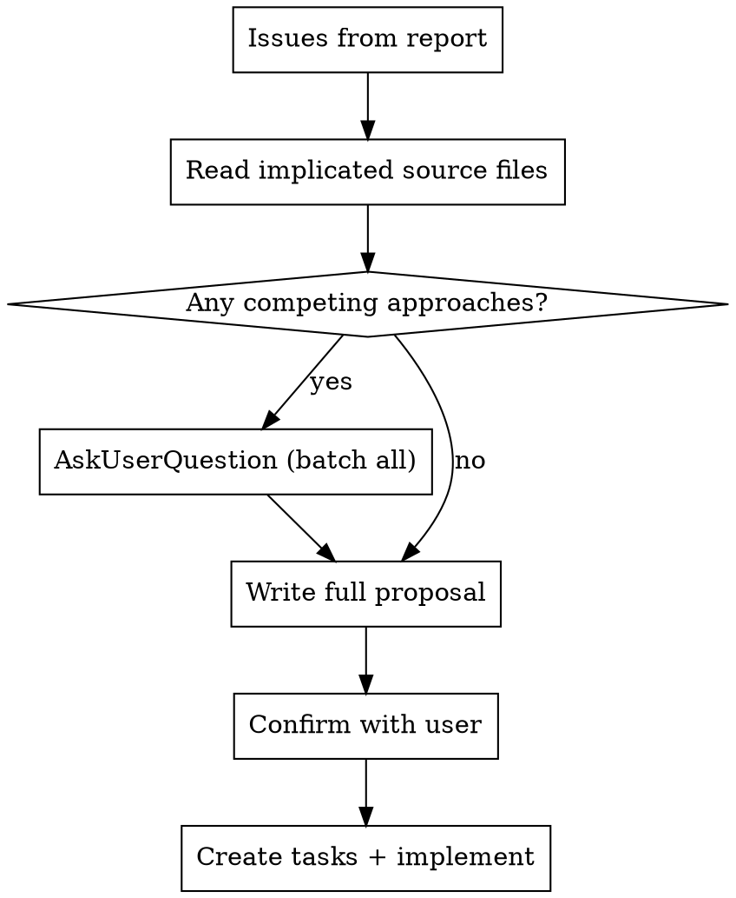

# Deep Reveal Judge

You are evaluating a batch of deep-reveal LLM explanations produced by `run_eval.mjs`.

## Core principle: the prompt is an artifact under test, not ground truth

The prompt is the thing the team controls, and **most response defects originate in the prompt** — empty-but-present sections, vocabulary injected without supporting data, sections that should exist but don't, instructions that contradict the data. Audit the prompt directly for these structural defects; never infer the prompt is correct just because you can't see it failing. A response that "fabricates a threat" is usually a prompt that demanded a pattern while withholding the data — score both. This skill therefore scores each entry on TWO axes: the response (the 9-item rubric) **and** the prompt (the integrity checklist below).

## Core principle: an absent grounding signal is a question, not a fact

The most valuable defects hide behind *missing* data, not wrong data. When a prompt has no look-ahead section, an empty threat comparison, or no concrete distinguishing feature, the easy move is to accept it ("nothing to ground, so a vague answer is fine"). That is the trap. Before accepting any absence, ask: **given what is actually true about this position, should that signal have been there?**

Establish the position's ground truth independently (from the solver score vectors on the record — see the grounding-sufficiency check), determine the *true* reason the better move is better, then ask whether the prompt carries any fact that could support that reason. When the response cannot argue the move **and** ground truth says it decisively should be arguable, the failure is **upstream**: a signal generator that was supposed to produce the reason either didn't run or is mis-designed. Do not file that as "vague response" — trace it to the generator (`runSparseLookahead`, the threat-comparison builder) and question whether its *logic* matches what the position needs. This is the difference between "the explanation was weak" and "the grounding pipeline is broken for this whole class of position."

## How to judge: start from the goal, then root-cause by the scientific method

Every check below serves ONE goal: **a deep-reveal explanation must make the player understand why their move was a mistake in an actionable way — a reason they can recognise on the board and apply next time.** The rubric, the prompt-integrity audit, and the grounding check are *instruments* for measuring distance from that goal — they are not the goal. Hold the goal first; the checklists are how you observe, not what you're judging.

For every entry, ask three questions in order:
1. **Goal** — what would this player need to hear to actually learn from this mistake?
2. **Achieved?** — does `final_response` deliver that (a concrete, board-findable, correctly-attributed reason), or only the *shape* of an explanation?
3. **If not, why?** — do not stop at "the response was weak." Run a root-cause analysis.

The root-cause analysis borrows the discipline of the `scientific-method-debugging` skill: **make the system show you what it produced, then form fine-grained hypotheses — never the reverse.** There are three layers between intent and output, and the bug can live in any of them:

- **Render layer** — the prompt text: sections, instructions, vocabulary. → the prompt-integrity audit observes it.
- **Context layer** — the data fed into the prompt: threat rows, look-ahead content, score cues. The context can be too thin to support the true reason even if rendered perfectly. → the grounding-sufficiency check observes it.
- **Generator layer** — the code that *produces* the context (`runSparseLookahead`, the threat-comparison builder, the classifier). It can run yet have logic that doesn't match what the position needs, producing nothing or the wrong thing.

Apply the method across these layers:
1. **Coarse hypothesis — where, not what.** From the failure, guess the layer (prompt malformed / context too thin / generator logic wrong). This only says where to look; discard it the moment data disagrees.
2. **Observe before explaining.** Get what each layer actually produced. For an entry, the rubric + `prompt_defects` + `grounding` fields ARE those observations. When the suspect is the generator, **observe it directly** — run it on the record's position (e.g. call `runSparseLookahead` with the record's movestring/cols and inspect what it returns and why) rather than reasoning about the code in your head.
3. **Refine from data.** Each anomaly is a hypothesis; verify what you can from data already in hand before gathering more.
4. **A ruled-out layer redirects upstream.** Render layer clean but the explanation is still ungrounded? The bug is upstream — the context was thin. Context thin? Ask which generator was supposed to produce it and whether its logic fits the position. Keep tracing upstream to the deepest cause.
5. **Fix the deepest cause first**, one root cause at a time, with a failing test (this is Phase 2).

The discovery that motivated this skill ran exactly this path: an explanation that couldn't argue the move (goal not met) → prompt had no look-ahead section (render looked thin) → the context was genuinely absent (grounding gap) → `runSparseLookahead` returned null → its exploration logic ("explore opponent *mistakes*") was wrong for a *winning* position (generator layer). Stopping at any earlier layer would have produced a cosmetic fix.

## The judge is an agent, not a text classifier — observe with tools

You can run tools; use them to OBSERVE ground truth instead of inferring it from the prompt text or reasoning in your head. This is the empirical backbone of every check here. Deciding "there is no minor threat there" by reading an ASCII board inside a prompt is a guess; running that position through the project's visualizer and reading its threat annotations is an observation. Prefer the observation whenever a claim is concrete and load-bearing.

Tools that aid judging:
- **`./visualize_board.sh <movestring>`** (from the project root) — the authoritative board view: a raw board, an annotated board marking every major/minor threat cell, the `par` row (per-column parity), the `scr` row (solver score per column), and an explicit major-threat list. Use it to fact-check any board-level claim — does the structure the explanation asserts actually exist? is that column really a same-colour line or an alternating stack? is the parity the reason depends on actually there? Construct the movestring as `board_state + correct_move` (after-best board) or `board_state + move_played` (after-played board).
- **The solver** — query scores directly (`createSolverProcess` from `server/c4solver-wrapper.js`) to confirm a move's true outcome or the score vectors.
- **The generator** — run `runSparseLookahead` / `searchOpportunities` on the record's position to see what context it produced and why; a null/empty tally is itself the observation. (When running it inline: pass `classifyFn`, wrap in try/finally with `solver.destroy()`, and guard already-won positions — these are known traps.)
- **Throwaway scripts & logging** — write a small script to check one specific condition, or add a log line to a generator and run it on the failing position, when a question can't be settled from existing output.

Be economical: there can be 50+ entries — reach for a tool when a claim is concrete and decision-changing, not for every adjective. The per-entry sub-agents (Step 2) run in the project root and have shell access, so they can use `./visualize_board.sh` directly to verify board claims rather than parsing the coach prompt's board by eye.

## Input

The argument is a path to a `.jsonl` file. Each line is a JSON object with this shape:

```json
{
  "id": "eval-0",
  "board_state": "3253...",
  "move_played": 2,        // 0-indexed column played (the blunder)
  "correct_move": 3,       // 0-indexed column that was better
  "pattern_category": "claimeven",
  "predicates": ["P02","P28"],
  "severity": 4,
  "context_outcome": "success | null_returned | trivial | all_moves_equal | error",
  "context_error": null,
  "is_sparse": true,
  "lookahead_fired": false,
  // Ground-truth solver score vectors (player-perspective, per-column, 0-indexed).
  // Required for the grounding-sufficiency check. If absent, that check degrades to
  // "unknown" — see the enrichment prerequisite note at the end of this file.
  "premove_scores":  [-2,-2,-2,1,-2,-2,-2],   // pre-move position (before either move)
  "best_scores":     [-1,-1,-1,-1,-1,-1,-1],  // opponent-perspective, after the better move
  "played_scores":   [-17,-17,2,-17,-17,2,-17], // opponent-perspective, after the played move
  "prompt": "<full LLM prompt>",
  "allowed_set": [...],
  "attempt1_response": "<raw LLM text>",
  "attempt1_passed": true,
  "attempt1_failures": [],
  "attempt2_response": null,
  "attempt2_passed": null,
  "attempt2_failures": [],
  "final_response": "<accepted response text or null>"
}
```

## Phase 1 — Score and report

### Step 0: Load human feedback (left-join)

Before classifying, look for a human-feedback sidecar file next to the results file. Its name is the results filename with `feedback_` inserted right after the `_results_` segment:

- results: `<dir>/eval_set_..._results_<ts>.jsonl`
- feedback: `<dir>/eval_set_..._results_feedback_<ts>.jsonl`

If the sidecar exists, read it (one JSON object per line: `{ "id", "human_note", "flagged_at" }`). **Left-join onto the eval records by `id`**: keep every eval record; for any record whose `id` appears in the sidecar, attach its `human_note` (the latest line wins if an id is flagged more than once). Records with no matching feedback line are unchanged. If the sidecar does not exist, proceed with no human notes.

A `human_note` is a human reviewer's **direction** for this specific case — what they believe is wrong. It is a prior to investigate, not ground truth: weight it heavily, but still verify against the solver/board. Carry it into the Step 2 sub-agent prompt for any record that has one.

### Step 1: Read and classify

Read the JSONL file. Classify each record into one of three buckets:

- **Pipeline failure**: `context_outcome` is not `success` — no LLM was called. Record the outcome type and `context_error` if present.
- **Annotation failure**: `context_outcome` is `success` but `final_response` is `null` — both validation attempts failed. Record the failure codes from `attempt1_failures` and `attempt2_failures`, and capture the full text of `attempt1_response` and `attempt2_response`.
- **Success**: `final_response` is non-null — will be scored in Step 2.

### Step 2: Score success records via sub-agents

For each success record, spawn a fresh `general-purpose` sub-agent to score the 9 rubric items. Process them **sequentially** (not in parallel — there can be 50+ entries). Each sub-agent receives only the data for that one record; it has no memory of other entries.

Construct the sub-agent prompt from this template, substituting the real values:

---
```
You are scoring a single Connect Four coaching explanation against a quality rubric.
Your output must be ONLY a valid JSON object — no prose, no markdown fences, nothing else.

You are an AGENT with shell access, not a text-only classifier. You are run from the project
root. For any board-level claim you must judge (rubric items 2 and 8, and the grounding check),
do NOT infer from the ASCII board pasted in the prompt — OBSERVE it: run
`./visualize_board.sh <movestring>` and read its threat/par/score annotations. Use
`<board_state><correct_move>` for the after-best board and `<board_state><move_played>` for the
after-played board. Reach for the tool when a structural claim is concrete and decision-changing
(e.g. the explanation asserts a threat/fork/line exists); don't run it for vague adjectives.

## Record metadata
- id: <id>
- board_state: <board_state> (pre-move movestring; append a 0-indexed column to get a board)
- move_played: <move_played> (0-indexed) → column <move_played + 1> (1-indexed, as used in the explanation)
- correct_move: <correct_move> (0-indexed) → column <correct_move + 1> (1-indexed, as used in the explanation)
- pattern_category: <pattern_category>
- severity: <severity>
- context_outcome: <context_outcome>
- is_sparse: <is_sparse if present on the record, else "unknown">
- lookahead_fired: <lookahead_fired if present, else "unknown">
- premove_scores: <premove_scores if present, else "unknown"> (player-perspective, per-column, 0-indexed)
- best_scores: <best_scores if present, else "unknown"> (opponent-perspective, after the better move)
- played_scores: <played_scores if present, else "unknown"> (opponent-perspective, after the played move)

Score semantics: a score is from the perspective of the player to move — `>0` win, `=0` draw, `<0` loss; higher absolute value = the outcome is decided SOONER (so `+7` wins sooner than `+5`; `-10` loses sooner than `-5`).

## Explanation to score
<final_response>

## Human reviewer direction (if present)
<human_note — include this section ONLY when the record has a joined human_note; otherwise omit it entirely>
A human reviewer flagged THIS explanation and wrote the note above describing what
they think is wrong. Treat it as a high-priority hypothesis to investigate: check
the items it points at first, and verify its claim against the solver/board with
your tools. It is a prior, not ground truth — if the evidence contradicts it, score
by the evidence and say so in `notes`.

## Full prompt sent to LLM
<prompt>

## Grounding-sufficiency check (do this FIRST — it establishes ground truth)

Using the solver score vectors above, independently determine the TRUE reason the better move is better, then check whether the prompt could possibly support it. This catches the highest-value defects: explanations that cannot be argued from the prompt at all.

Step A — classify the true distinguishing reason from `premove_scores` (let optScore = score of column <correct_move>, blunderScore = score of column <move_played>):
- `outcome_flip` — optScore ≥ 0 and blunderScore < 0: the better move holds a win/draw, the played move loses. The reason is "best defense punishes the played move."
- `speed` — same sign, different magnitude (both > 0, or both < 0): the moves agree on the outcome but differ on how fast (win sooner / lose later). The reason is about tempo, not a structure.
- `tactical_structure` — a threat/fork/look-ahead structure genuinely distinguishes the moves (threat rows shown, or a `## What the better move leads to` section present and non-empty).
- `parity_positional` — no tactical structure and no score gap the prompt expresses; the edge is quiet (center control / parity / zugzwang).
- `none` — the moves are genuinely equivalent (premove optScore == blunderScore).
If scores are "unknown", set reason to "unknown" and skip Step C.

Step B — decide whether the gap is DECISIVE: an `outcome_flip`, or a `speed`/`tactical` gap large enough that a competent explanation should be able to name a concrete consequence.

Step C — grounding sufficiency: does the prompt contain ANY fact that could support the true reason? (A look-ahead section, a threat row, a parity/par-row cue, named cells/columns.)
- If the gap is decisive AND the prompt contains no supporting fact → this is a **grounding gap**: the explanation cannot be argued from the prompt even in principle. Record it (see `grounding_gap` output) with the reason type and what was missing. Cross-check: if `lookahead_fired` is false (or there is no look-ahead section) on a decisive position, the look-ahead generator failed to surface the reason — name `runSparseLookahead` as the suspected upstream cause.
- If the gap is genuinely `none` (moves equivalent), a brief honest explanation is correct — NOT a grounding gap.

## Prompt integrity audit (do this BEFORE the rubric)

Audit the PROMPT TEXT above as a defective artifact — independent of the response. Many response failures are caused by a malformed prompt, and that root cause is invisible if you only score the response. Check each of these and record any that apply in the `prompt_defects` output array:

- `empty_section` — a `##` section is present but its body is blank or contains only labels with no data under them (e.g. a `## Threat comparison` whose three snapshots are all empty). An empty section that still carries instructions ("when citing a threat count…") actively primes the model to invent that content.
- `vocab_without_data` — a `[term:X]` concept is injected in the KB term definitions, but no data section actually instantiates it (e.g. `[term:minor_threat]` is defined but no minor-threat row/count appears anywhere). Naming a concept with no concrete instance invites fabrication.
- `missing_expected_section` — a section that SHOULD be present for this record is absent. Key check: if `is_sparse` is true (or the position is plainly sparse) and there is **no** `## What the better move leads to` (forward look-ahead) section, flag it — the look-ahead failed to fire and the prompt has no concrete distinguishing feature to offer.
- `instruction_data_contradiction` — the task instructions demand something the data can't support (e.g. "Name the tactical pattern that was missed" while all threat rows AND the look-ahead section are empty/absent, leaving no pattern to name).
- `direction_mismatch` — a structure (threat/fork) exists on the **blunder** board but is hidden from the comparison because the comparison only shows the best-move direction; the vocabulary leaks in but the true story (the blunder created the threat, as a distraction) cannot be told.

For each defect, write the concrete evidence (which section, which term, which board). If none apply, return an empty array.

## Pre-check: primary pattern identification

Before scoring, identify the PRIMARY tactical concept in the explanation — the
central claim about what the player missed, had, or gave away. Look at the main
clause of the opening sentence (or the concept most prominently framed as the
blunder diagnosis). Extract it as a short phrase.

Expected primary concept per category:
- claimeven        → "claimeven" / "even-row pairing"
- forced_win       → "forced win" / "forcing sequence"
- double_threat    → "double threat" / "fork" / "two threats"
- z_threat         → "Z-shape" / "parity advantage" / "odd capsule"
- figure_7         → "figure-7" / "diagonal fork"
- j_shape          → "J-shape"
- undercut         → "undercut" / "lower threat"
- overcut          → "overcut" / "upper threat"
- immediate_threat → "immediate threat" / "winning move right there"
- forced_block     → "forced block" / "opponent was about to win"
- drawing_move     → "draw" / "drawing resource" (NOT "forced win")
- odd_even_threat  → "odd-even threat" / "both parities" / "parity fork"
- suboptimal_move  → a reproducible board feature the player could find on their own (parity, a reachable fork/threat, who-completes-first, specific cells/columns). A purely generic positional claim with no board-grounded reason does NOT satisfy this — score it against item 9.

Write one line before the rubric scores:
`Primary pattern: "<phrase>" — matches / DOES NOT MATCH <pattern_category>`

Use this determination in item 3 scoring.

## Rubric

Score each item "pass", "partial", or "fail".

| # | Item | What to check |
|---|---|---|
| 1 | Correct column named | Does the explanation explicitly mention column <correct_move + 1>? Does it avoid naming wrong columns as the better move? |
| 2 | No hallucinated win or structure | Does it claim an immediate win exists when none does, or deny one when it does? Cross-check: `forced_win` pattern_category means a win exists; high severity alone does not. Also check: does the explanation assert a tactical structure (e.g. "major threat alive", "fork in place", "forcing sequence") that the boards do not show? The board visualizations explicitly state "Major threats: none" when there are none — if the explanation claims a major threat, minor threat, or concrete forcing structure exists when the boards show none, score fail. |
| 3 | Pattern match | Recall the primary pattern from the pre-check. Does it match `<pattern_category>`? The PRIMARY claim (the central blunder diagnosis — what the player missed or had) must match. Secondary supporting concepts mentioned alongside (e.g. `[term:parity]` inside a z_threat explanation) are acceptable. If the primary concept names a DIFFERENT pattern (e.g. "forced win" when category is `drawing_move`), score fail — even if the correct concept also appears elsewhere in the response. Mapping for secondary concepts: claimeven → zugzwang / even-row control; forced_win → forced sequence / forced win; double_threat → fork / two threats at once; z_threat → Z-shape / odd-row stacking; figure_7 → figure-7 / diagonal staircase; j_shape → J-shape; undercut → undercut / lower threat; overcut → overcut / upper threat; immediate_threat → immediate threat / blocking urgency; forced_block → forced block / defensive urgency; drawing_move → drawing / balanced outcome; odd_even_threat → parity / odd-even row strategy; suboptimal_move → a reproducible board feature (parity / reachable fork / threat / who-completes-first / specific cells); a generic positional claim with no player-findable reason is NOT a valid primary concept — score it against item 9. |
| 4 | Player perspective correct | Is the explanation from the blundering player's viewpoint ("you missed…", "your move…")? No confusion about who played vs who benefits. |
| 5 | Move location accuracy | Are the played move (column <move_played + 1>) and better move (column <correct_move + 1>) correctly attributed? No transposition between the two. |
| 6 | No internal terms leaked | Does the response use any banned words: `solver`, `score`, `leaf`, `leaf position`, `tag`, `direction`, the literal snake_case token `forced_win` (the natural phrases "forced win" / "forcing sequence" ARE allowed — see the item-2 term map), `simulation`, `pattern data`, `pattern comparison`? |
| 7 | Internal consistency | Does the better move's rationale directly address the specific weakness identified in the blunder? The diagnosis and remedy must be logically connected — not just "the other move was stronger." |
| 8 | Other issues | Anything not covered by another item: self-contradictory claims, wrong threat direction, misleading framing, factual errors about the board. Do NOT score vague/boilerplate / non-reproducible reasoning here — that now lives in item 9; do not double-count it. |
| 9 | Reproducible reasoning | Is the explanation's core reason a board feature the player could identify on their own — a threat, parity, a reachable fork, who-completes-first, specific cells/columns — rather than a score-flavored assertion ("stronger move", "loses slower", "higher-rated", "better evaluation") or generic positional filler ("kept your options open", "more room to build", "kept the structure intact", "lining up cleanly")? Score fail when the reason is score-flavored or generic filler; pass when it names a concrete, player-findable board feature. **Honest-minimal exception (do not over-penalize honesty):** if no board feature genuinely distinguishes the moves AND the prompt offered none, a brief honest explanation is acceptable — score pass/partial, not fail. **But this exception applies ONLY when the grounding-sufficiency check classified the reason as `none` (moves equivalent).** If that check found a DECISIVE gap with no supporting fact in the prompt (a grounding gap), the brevity is NOT acceptable honesty — it is the symptom of an upstream failure: score item 9 fail and record the `grounding_gap`. Do not let an honest-sounding vague answer mask a decisive position the pipeline failed to ground. **Checkable rule:** if the prompt contains a `## What the better move leads to` section (forward look-ahead), the explanation MUST use that concrete content; ignoring it and staying vague is fail. If no such section exists and the boards show no distinguishing feature AND the reason was `none`, brevity is acceptable. |

## Output format

Return exactly this JSON (fill in real values, no comments):
{
  "id": "<id>",
  "scores": {
    "1": "pass|partial|fail",
    "2": "pass|partial|fail",
    "3": "pass|partial|fail",
    "4": "pass|partial|fail",
    "5": "pass|partial|fail",
    "6": "pass|partial|fail",
    "7": "pass|partial|fail",
    "8": "pass|partial|fail",
    "9": "pass|partial|fail"
  },
  "notes": "<one line per non-pass item: 'item N fail — reason; item M partial — reason'. Empty string if all pass.>",
  "causes": "<for each non-pass item, one line identifying the likely root cause in the prompt that led to this failure — e.g. 'item 3: prompt does not name the pattern category, LLM guessed from board context'. Empty string if all pass.>",
  "prompt_defects": [
    {"type": "empty_section|vocab_without_data|missing_expected_section|instruction_data_contradiction|direction_mismatch", "evidence": "<concrete: which section/term/board>"}
  ],
  "grounding": {
    "true_reason": "outcome_flip|speed|tactical_structure|parity_positional|none|unknown",
    "decisive": true,
    "grounding_gap": false,
    "missing": "<if grounding_gap: what fact the prompt lacked to support the true reason>",
    "suspected_generator": "<if grounding_gap: the upstream signal generator that should have produced it, e.g. runSparseLookahead — else empty>"
  }
}

Note: `prompt_defects` and `grounding` are independent of the rubric scores — a prompt can be defective, or a position decisively ungrounded, even when the response happens to pass all 9 items. You MUST still report both.
```
---

Collect each sub-agent's JSON result as it completes. If a sub-agent returns malformed JSON or fails to respond, record it as all-fail with notes "sub-agent error".

### Step 3: Write the report

Write the report to `<same-directory>/<stem>_report.md` where `<stem>` is the filename without `.jsonl`.

```
# Deep Reveal Eval Report — <filename>

## Summary

- Total entries: N
- Pipeline failures: N
- Annotation failures: N  
- Successes evaluated: N
- Rubric pass rate: X/Y items passed across all success entries

## Pipeline failures

| id | category | outcome | error |
|----|----------|---------|-------|
...

## Annotation failures

| id | category | attempt1_failures | attempt2_failures |
|----|----------|------------------|------------------|
...

For each annotation failure, add a block immediately below the table:

> **eval-N attempt 1** (`failure_code1, failure_code2`):
> <paste attempt1_response verbatim>
>
> **eval-N attempt 2** (`failure_code1, failure_code2`):
> <paste attempt2_response verbatim>

## Per-entry rubric scores (success entries)

| id | category | sev | 1 | 2 | 3 | 4 | 5 | 6 | 7 | 8 | 9 |
|----|----------|-----|---|---|---|---|---|---|---|---|---|
...

For each row where any item is partial or fail, add a notes block immediately below:
> eval-N: item 3 fail — explanation describes "column pressure" but pattern is claimeven; item 7 partial — better move rationale is generic
> Causes: item 3 — prompt does not name the pattern category; item 7 — Move context section lacks concrete positional detail

## Systematic issues

Group failures by rubric item. For each item with ≥2 failures:
- How many entries affected
- Which pattern_category values are involved
- A one-sentence description of the recurring failure pattern

Order by number of entries affected, descending.

## Systematic prompt defects

Aggregate the `prompt_defects` arrays across ALL entries (not just failing ones — a passing response can still come from a defective prompt). Group by defect `type`. For each type with ≥1 occurrence:
- How many entries affected, and which ids
- The recurring evidence (which section / term / board)
- One sentence on the prompt-construction bug it points to

Order by number of entries affected, descending. This section is the bridge to Phase 2: each prompt-defect type that recurs is a candidate fix in the prompt-builder source, even if no rubric item failed because of it.

| defect type | entries | ids | evidence |
|-------------|---------|-----|----------|
...

## Decisive-but-ungrounded cases (highest-value design signal)

Aggregate every entry whose `grounding.grounding_gap` is true — a position with a decisive reason that the prompt could not support. This is the most important section of the report: it is where "the explanation was weak" becomes "the grounding pipeline is broken for a whole class of position." A single such case is worth investigating; a cluster sharing a `suspected_generator` is a design defect, not a tuning problem.

| id | category | true_reason | lookahead_fired | suspected_generator | missing |
|----|----------|-------------|-----------------|---------------------|---------|
...

Then group by `(true_reason, suspected_generator)`. For each group with ≥1 entry, write one sentence on what the generator was supposed to produce and why it didn't — and explicitly ask whether the generator's *logic* (not just whether it ran) matches what this class of position needs. Carry every group into Phase 2 as a generator-level investigation, not a renderer tweak.

## Raw explanations (success entries)

For each success entry, print:

### eval-N — <pattern_category> (sev <severity>)
**Full prompt:**
<paste prompt>

**Final response:**
<paste final_response>
```

## Key column-number rule

`move_played` and `correct_move` are 0-indexed. The LLM prompt and response use 1-indexed columns. When checking rubric items 1 and 5, add 1 to each value before comparing against what the explanation says.

---

## Phase 2 — Root-cause analysis, fix proposal, and implementation

After the report is written, execute this phase in order. Do not skip steps. This phase IS the root-cause analysis described in "How to judge" above — applied to the report's *systematic* findings rather than a single entry. Work each finding from output back toward its deepest cause; do not propose a fix until you have located the layer (render / context / generator) where the bug actually lives.

### Step 1: Locate the layer — observe before explaining

For each systematic issue, **each systematic prompt defect, and each decisive-but-ungrounded group** in the report, form a coarse hypothesis about which layer owns it, then OBSERVE that layer before proposing anything. A prompt-defect type is a fix candidate even when no rubric item failed because of it; a grounding gap is a fix candidate at the *generator* level even when the renderer is blameless.

How to observe each layer:
- **Render / context layers** → read the source file(s) that build the prompt and its data sections (mapped below). Reading is enough here: the defect is visible in how the section is assembled.
- **Generator layer** → do NOT reason about the code in your head. **Run the generator on a representative failing entry** and look at what it returns and why — e.g. for a look-ahead grounding gap, call `runSparseLookahead` (or `searchOpportunities`) with that record's movestring/cols and inspect the tally. A null/empty result is itself the observation that tells you whether the generator's *logic* (not its depth or budget) is the cause. Use the record's `lookahead_null_reason` if present to skip straight to the failure mode.

If observing one layer rules it out, redirect upstream (Step 4 of the method): a clean render layer over an ungrounded explanation means the context was thin; a thin context means a generator under-produced. Trace to the deepest cause before writing any fix.

Source map — where to look per finding type:

- **Annotation failures (P3/P5/P5Strong codes)** → `server/annotationGate.js`
- **Prompt information gaps (items 3, 7)** → `server/llmCoachHelpers.js` (the `buildBlunderExplainPrompt` function and Move context section), `server/explainContext.js`
- **Leaked internal labels in KB term definitions** → `server/explainContext.js` (the `kbTermLines` build loop)
- **Validator strictness / false rejections** → `server/annotationGate.js` (`checkP3`, `checkP5`)

Map each prompt-defect type to its source:
- `empty_section` → `server/explainContext.js` — the section-build step that emits the section unconditionally (e.g. `threatComparisonSection` is built regardless of whether any rows show); the fix is a guard that omits the whole section when its body would be empty.
- `vocab_without_data` → `server/explainContext.js` — the KB-term inclusion criterion (`hasMajorThreats`/`hasMinorThreats`, `always_include`) vs. the data-section visibility criterion (`showPlayerMinor`, etc.); a defect means the two criteria disagree.
- `instruction_data_contradiction` → `server/llmCoachHelpers.js` — the `patternInstruction` gate (it flips on `kbTermsSection` being non-empty, which is driven by always-include glossary terms like parity/gravity_top, not by a real pattern firing).
- `missing_expected_section` → `server/explainContext.js` (the `runSparseLookahead` / `isAnchorlessPosition` look-ahead gate) and the underlying look-ahead implementation.
- `direction_mismatch` → `server/explainContext.js` — the `show*` direction flags (`bestStats.* > blunderStats.*`) vs. the KB-term inclusion that counts the blunder board.

Map each decisive-but-ungrounded group to its signal generator, and interrogate the generator's LOGIC, not just whether it ran:
- `suspected_generator: runSparseLookahead` → `server/sparseLookahead.js`. Ask: does its exploration strategy match what THIS class of position needs? (e.g. a position the player wins under best play needs the opponent's *optimal* replies explored — exploring opponent *mistakes* there rewards the blunder, which produces null or a backwards result.) A grounding gap clustered here is a design defect in the exploration/comparison logic, not a depth or budget tweak.
- grounding gaps with `true_reason: parity_positional` and no generator → there may be **no** generator producing a parity/positional reason at all; the fix is to add one (or to render the score-tier/par-row cue honestly), not to tune an existing one.
- grounding gaps with `true_reason: speed` → the magnitude difference exists in the score vectors but no prompt section expresses tempo; consider whether the prompt should surface "wins/loses sooner vs later" as a grounded cue.

Read only the files and functions actually implicated. Do not read the entire codebase.

### Step 2: Identify competing approaches

For each issue, determine whether there is one obvious fix or multiple competing approaches. A competing approach exists when:
- Two different layers of the system could own the fix (e.g., fix at prompt-build time vs. fix at validation time)
- A fix has a meaningful trade-off that the user should weigh (e.g., looser validation vs. richer prompt data)
- The scope of the fix is ambiguous (minimal targeted change vs. broader refactor)

When competing approaches exist, use AskUserQuestion **before** writing any proposal text. Each question must offer ≥2 options. Ask at most 4 questions total. Batch all questions into a single AskUserQuestion call.



### Step 3: Write full proposal

Present all proposed fixes in a single response. For each fix:

- **Issue**: one sentence naming the rubric item and root cause
- **Fix**: what changes in which file/function, and why
- **Trade-offs**: any costs or risks the user should know about

Use a numbered list, one fix per number. If a fix was shaped by a user answer in Step 2, reference the chosen approach.

### Step 4: Confirm with user

After presenting the proposal, call AskUserQuestion with exactly these two options:

- **Implement all** — proceed with the full proposal as stated
- **Revise first** — user wants to change the scope or approach before implementation starts

Do not begin implementation until the user selects "Implement all" (or equivalent). If they select "Revise first", update the proposal based on their feedback and ask again.

### Step 5: Create tasks and implement

1. Call TaskCreate for each fix — one task per distinct file change. Set each task to `in_progress` before starting it and `completed` immediately when done.
2. Implement the fixes in the order they appear in the proposal.
3. After all edits, run the test suite (`npm run test:fast` from `connect-four/`) to confirm no regressions. Fix any failures before reporting completion.


